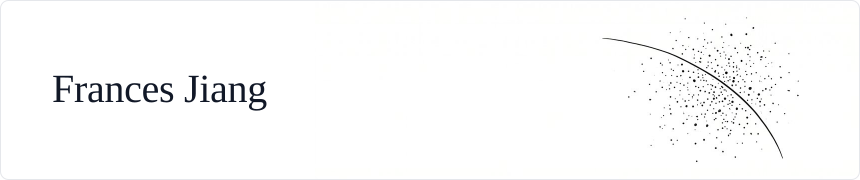
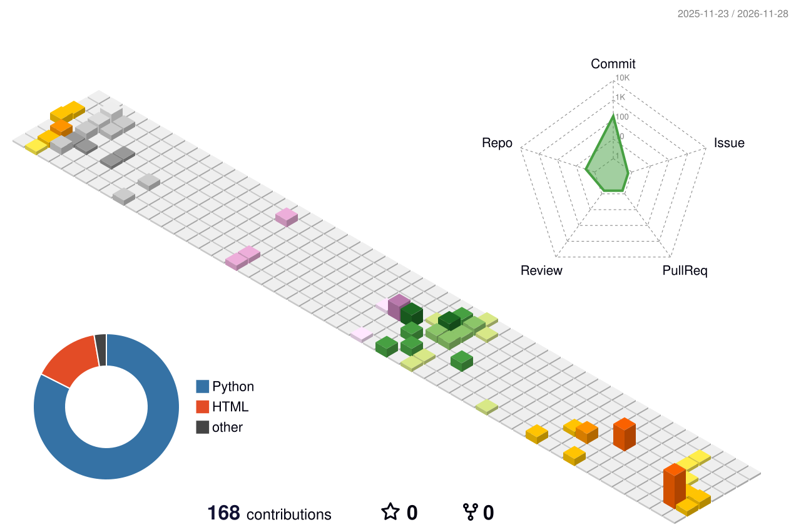

  

  &nbsp;&nbsp;
  &nbsp;&nbsp;
  

---

### About

I'm Frances, a Master's student in Logistics Engineering and Management with five years of prior experience as a software engineer. Now, my research focuses on operations research and logistics management, where I develop mathematical models and algorithms to solve transportation network and logistics planning problems.

### Currently exploring

- Transportation and logistics systems under uncertainty
- Operations research and the Physical Internet
- AI for science
- Reproducible agent workflows

### Explore more

| Focus | Link |
| :--- | :--- |
| What do I study? | [**Research Profile**](https://francesbhjiang.github.io/profile/) |
| What do I create? | [**Open Source**](https://github.com/francesbhjiang?tab=repositories) |
| How do I experience the world? | [**My Summertime**](https://francesbhjiang.github.io/MySummertime/) |

### 365 Days of building

  

